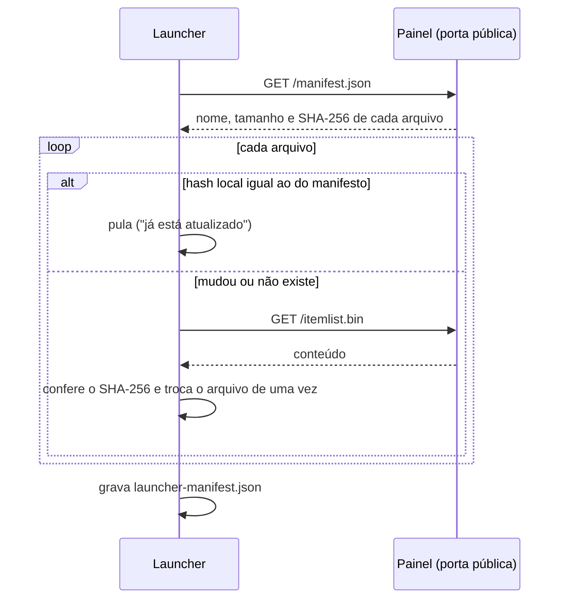

# Relatório de organização — 12/11/2026

Varredura dos três projetos (`wyd-go-server`, `wyd-client` e
`wyd-others/Release Cliente`): limpeza, documentação, a melhoria do launcher
com manifesto de hashes, problemas encontrados e vulnerabilidades.

## Resumo

| Item | Resultado |
|---|---|
| READMEs | Reescritos nos três projetos, com diagramas Mermaid e capturas do jogo |
| Launcher | Passou a ler `manifest.json` do painel e só baixa o que mudou (feito, com testes) |
| Repositório do cliente | 64 arquivos removidos (40 MB): backups `.bak`, headers órfãos, libs x86 |
| Release do cliente | 56 entradas (259 MB) movidas para quarentena; pasta foi de 1,7 GB para 1,5 GB |
| Problemas encontrados | 14 (seção 4) |
| Vulnerabilidades | 12 (2 altas, 5 médias, 5 baixas), seção 5. V1 corrigida no mesmo dia. |

Nada foi commitado: as mudanças estão no working tree dos dois repositórios
para revisão.

## 1. O que foi validado, e o que não foi

- **Servidor**: `go build ./...`, `go vet` e `gofmt -l` sem apontamentos; os
  testes de `internal/admin` que cobrem manifesto, itemlist, serverlist e
  página do launcher passam. A suíte completa (`go test ./... -p 1`, que apaga
  o banco `dbsrv_test`) **não** foi executada.
- **Launcher**: `go vet` para Linux e Windows e `go test` passam (31 testes,
  6 deles novos, do manifesto).
- **Cliente C++**: depois da limpeza, o build do Linux (mingw-w64) foi refeito
  em uma pasta temporária, sem tocar em `build-linux/` nem na release. 
  Compilou e linkou sem erros.
- **Não validado**: o build do Windows (Visual Studio), porque esta máquina é
  Linux. As mudanças que o afetam são só a remoção de 9 linhas `ClInclude` do
  `TMProject.vcxproj` (headers que nenhum arquivo inclui) e da pasta
  `Dependencies/Directx/Lib`, que não está em nenhum `LibraryPath`. Nada foi
  testado dentro do jogo.

## 2. Melhoria: manifesto de arquivos com hash

### Como era

A cada abertura o launcher baixava `serverlist.bin` (7 KB) e `ItemList.bin`
(1 MB) inteiros, mesmo sem mudança, e a única conferência era o tamanho.

### Como ficou

O painel serve `GET /manifest.json` na porta pública:

```json
{"version":1,"files":[
  {"name":"serverlist.bin","path":"/serverlist.bin","size":7040,"sha256":"…"},
  {"name":"ItemList.bin","path":"/itemlist.bin","size":1014000,"sha256":"…"}
]}
```



Decisões:

- **Compatível nos dois sentidos.** Launcher novo com painel antigo (sem
  manifesto, 404) baixa tudo como antes. Launcher antigo com painel novo ignora
  a rota. Não é preciso distribuir os dois juntos.
- **`launcher-manifest.json` na pasta do jogo.** Com o IP fixado nas
  Configurações (`Servidor.txt`), o launcher reescreve o `serverlist.bin`, e o
  hash em disco nunca é o do servidor. O estado guarda o hash do servidor, o do
  arquivo gravado e o endereço aplicado; trocar ou apagar o endereço força novo
  download.
- **Integridade.** O conteúdo baixado tem de bater com o hash anunciado; se
  não bater, a cópia local é mantida. Isso pega download corrompido ou cortado,
  **não** um atacante na rede (ver V2: o manifesto vem pelo mesmo HTTP).
- **Custo no servidor.** O manifesto é recalculado no máximo a cada 5 s e o
  `ItemList.bin` em memória é um só, compartilhado com a rota do arquivo.
- **Lista fechada.** O launcher só atualiza os dois arquivos que ele já
  conhece, mesmo que o manifesto liste outros. Aceitar qualquer nome permitiria
  ao servidor (ou a quem interceptar o HTTP) gravar um `WYD.exe`.

Arquivos: `internal/admin/manifest.go` (+ teste), `internal/admin/itemlist.go`
(cache extraído em `ItemListCache`), `cmd/admin/main.go` (rota), e no cliente
`Projects/WYDLauncher/update.go` (+ testes).

### Próximo passo natural

Assinar o manifesto (Ed25519, chave pública embutida no launcher) e só então
abrir a lista para qualquer arquivo do cliente, inclusive `WYD.exe`. Isso vira
um atualizador completo: hoje um jogador precisa baixar a release inteira
(1,5 GB) a cada mudança de arte ou de executável.

## 3. Arquivos removidos

### 3.1 `wyd-client` (git, recuperável pelo histórico)

| O quê | Por quê |
|---|---|
| `TMFieldScene.cpp.bak`, `.bak2`, `TMSelectServerScene.cpp.bak`, `.bak2`, `ObjectManager.cpp.bak2` | Cópias de segurança de 08/11 (1,9 MB). O git já guarda o histórico. |
| `AES.h`, `Base64.h`, `BlockKeyBoard.h`, `MD5Checksum.h`, `NewClientB.h`, `Quest.h`, `ReconectDataManager.h`, `StackWalker.h`, `desbase64.h`, `md5.h` | Nenhum `.cpp`, `.h` ou `.rc` os inclui e nenhum identificador deles aparece no código. Saíram também do `.vcxproj` e do `.filters`. |
| `Dependencies/Directx/Lib/` (48 libs, 28 MB) | Libs x86 do DirectX SDK. O cliente é só x64 e o `LibraryPath` aponta apenas para `Dependencies/D3DX/Lib64` e para o Windows SDK. |
| `Infos/Files Name.txt` | Lista solta de nomes de arquivo, sem uso. |

Mantido de propósito: `Dependencies/Directx/Include` (ver P10).

### 3.2 `Release Cliente` (sem git: quarentena, não exclusão)

A pasta não tem controle de versão, então nada foi apagado. Os arquivos foram
**movidos** para `wyd-others/_removidos-release-cliente-2026-11-12/`. Depois de
abrir o jogo e confirmar que está tudo certo, apague a quarentena:

```sh
rm -rf "/home/gefferson/git/wyd-others/_removidos-release-cliente-2026-11-12"
```

Para desfazer, mova o conteúdo de volta.

Critério: o nome não aparece nos textos do `WYD.exe` (mingw x64), do
`JogarWYD.exe` nem do `WYD-Linux`, e não é importado por nenhum dos três.

| Grupo | Arquivos |
|---|---|
| Executáveis antigos | `WYD.exe.bak`, `WYD_x86.exe`, `orig.WYD.exe` (todos 32 bits), `WYD.pdb` (de 2025, de outro build), `serverlist.bin.bak` |
| Launcher antigo (.NET / Adobe AIR) | `Adobe AIR/`, `META-INF/`, `pt-BR/`, `DotNetZip.dll`, `DotNetZip.xml`, `Interop.WMPLib.dll`, `settings.txt`, `Launcher.hat`, `libcurl-d.dll`, `zlibd1.dll` |
| Proteção antiga (JProtect) | `JProtectDll.dll`, `JPGLib.dll`, `jlock101.sys/.VXD`, `jlock102.sys/.VXD` |
| Runtimes do Visual C++ | `msvcp120.dll`, `MSVCP120D.dll`, `msvcr120.dll`, `MSVCR120D.dll`, `msvcp140.dll`, `msvcp140d.dll`, `msvcr100.dll`, `msvcr100d.dll`, `ucrtbase.dll`, `ucrtbased.dll`, `vcruntime140.dll`, `vcruntime140d.dll`. O `WYD.exe` é estático (`/MT` no Visual Studio, `-static` no mingw). |
| Correções para o cliente 32 bits | `Correção manual/` (88 MB de instaladores), `melhorar grafico/`, `d3dx9_42.dll` |
| Dados sem leitura | `curse.bin`, `droplist.txt`, `extraitem.bin`, `HeightMap.dat` (16 MB), `InitItem.bin`, `MountData.bin`, `Music.ini`, `sound.txt` (vazio), `shader1.bin` a `shader8.bin` (o cliente lê `shader/*.bin`), `strdef/` |
| Lixo | `dbgbtn.txt` (80 MB de log de depuração), `Thumbs.db` |
| Duplicado | `Itemlist.bin` (ver P1) |

Ficaram na release, de propósito: `ScreenShot/` (150 MB, são capturas suas),
`clientlogs.log` (o jogo recria) e `wine/` (725 MB, gerado pelo `bundle`).
Nenhum dos três deve ir no pacote distribuído aos jogadores.

Não auditado: o conteúdo de `mesh/` (6.639 arquivos), `UI/`, `Effect/`, `Env/`
e `Sound/`. Os nomes vêm de listas binárias, e conferir exige carregar essas
listas (ver M6).

## 4. Problemas encontrados

| # | Problema | Situação |
|---|---|---|
| P1 | A release tinha `Itemlist.bin` (11/11) e `ItemList.bin` (12/11). No Windows é um arquivo só; no Linux são dois, e o Wine podia abrir o antigo. | Corrigido: o antigo foi para a quarentena. |
| P2 | `CMakeLists.txt` usava a pasta padrão `Release LInux Cliente`, que não existe; só funcionava porque o `wyd-linux.sh` passa a pasta certa. | Corrigido para `Release Cliente`. |
| P3 | `TMPaths.h` traz `GameURLMark = "http://192.168.3.10/…"` fixo no código. Quem não tiver `guildmark.txt` busca marcas de guilda num IP privado. | Aberto. Derivar do `serverlist.bin`, como o launcher já faz. |
| P4 | O README do cliente descrevia o projeto original (pasta `Descompilations`, tool de itemlist, VS 2019) e não as mudanças feitas. | Corrigido no README novo. |
| P5 | Mensagens de commit sem informação (`fixx`, `aa`, `ate aqui ok`, `implements` ×3). Não dá para achar quando algo mudou. | Aberto. Ver M1. |
| P6 | `Release Cliente` (1,5 GB) não tem versão, backup nem manifesto. Um arquivo trocado por engano não tem volta. | Aberto. Ver M2. |
| P7 | `backups/` não tem rotação: já são 15 dumps em 5 dias, e os `pre-deploy` se acumulam. | Aberto. Ver M3. |
| P8 | A release distribuía DLLs de depuração (`*d.dll`), um `.pdb` e 80 MB de log. | Corrigido (quarentena). |
| P9 | `ServerListHandler` lê e interpreta o `tmsrv.yaml` (74 KB) a cada requisição da porta pública, sem cache. | Aberto. O manifesto já usa cache de 5 s; fazer o mesmo na rota do arquivo. |
| P10 | `Dependencies/Directx/Include` tem 204 headers e o projeto alcança 30 (o resto é D2D, D3D10/11, XAudio…). | Aberto. Não removi porque o build do Windows não pôde ser validado aqui. |
| P11 | `config/npc_generators.yaml` (65.734 linhas) só é lido uma vez, para preencher a tabela vazia. | Aberto. Pode sair do repositório quando a exportação do painel for a única fonte. |
| P12 | `docs/auditoria-2026-11-07.md` e `docs/tmsrv-port.md` citam a pasta `data/`, o `cmd/gamedata-import` e o `/sgm`, que não existem mais. | Aberto. São históricos; marcar como tal no topo. |
| P13 | O servidor trata o pacote 0x634 (aviso de WPE do JProtect), mas o cliente novo não carrega mais o JProtect. É código morto dos dois lados. | Aberto. Remover ou substituir (ver V11). |
| P14 | `go.mod` do launcher declara `go 1.22` e o do servidor `go 1.26.0`, mas a toolchain local é 1.26.8, com falhas conhecidas (V3). | Aberto. |

## 5. Vulnerabilidades

O painel está bem cuidado e não entrou na lista: senha em argon2id, CSRF por
sessão, cookie `HttpOnly` + `SameSite=Strict`, CSP restritiva, bloqueio por
tentativas e escuta só em `127.0.0.1`. O cadastro público limita por IP e o
tamanho do corpo. Nenhum segredo foi encontrado no histórico do git dos dois
repositórios.

### Altas

**V1 — O protocolo do jogo não tem criptografia de verdade.** *Corrigido em
12/11: ver `docs/transporte-seguro.md`. O texto abaixo descreve como era.*
A "cifra" do WYD é uma tabela fixa (`internal/protocol/keytable.go`), igual em
todo cliente. Quem captura o tráfego (Wi-Fi aberto, provedor, lan house) lê
usuário e senha do login.
*Correção:* como agora controlamos cliente e servidor, trocar a tabela por um
acordo de chaves no hello (X25519) e cifra autenticada por conexão
(ChaCha20-Poly1305), mantendo o formato dos pacotes por dentro. Enquanto isso:
senha numérica obrigatória e aviso para não reutilizar senha.

**V2 — Tudo o que o launcher e o cadastro usam é HTTP sem TLS.**
`serverlist.bin`, `ItemList.bin`, `manifest.json`, a página do launcher e o
cadastro (`/register`, com a senha no corpo) trafegam em claro. Um atacante na
rede pode: (a) entregar um `serverlist.bin` apontando para um servidor falso e
colher senhas; (b) ler a senha do cadastro; (c) servir HTML malicioso para o
navegador embutido do launcher, que é o motor legado do Internet Explorer (MSHTML) no Windows
e o wine-gecko no Linux.
*Correção:* pôr um proxy com TLS na frente da porta pública (Caddy resolve com
três linhas e certificado automático), fazer o launcher exigir `https://` e
assinar o manifesto (Ed25519). O hash do manifesto, sozinho, não autentica
nada: ele vem pelo mesmo canal. Trocar o controle de navegador por WebView2
no Windows, ou mostrar só a arte local.

### Médias

**V3 — Toolchain do Go com 14 falhas conhecidas da biblioteca padrão.**
`govulncheck` (go 1.26.8) aponta 14 falhas alcançadas pelo código, quase todas
em `net/http`, que é exatamente a porta pública: queda do servidor HTTP/1 por
corrida no `MaxBytesReader` (GO-2026-6859), consumo de memória por cabeçalhos
MIME (GO-2026-6608) e por `Range` (GO-2026-6609), dessincronização de conexão
(GO-2026-6613), e duas em `html/template` (GO-2026-6599, GO-2026-6600).
*Correção:* compilar com Go ≥ 1.26.11 (corrige todas), fixar
`toolchain go1.26.11` no `go.mod` e a tag exata no `Dockerfile`
(`golang:1.26.11-alpine` em vez de `1.26-alpine`). Rodar `govulncheck ./...`
antes de cada deploy.

**V4 — Sem limite de conexões por IP nas portas do jogo.**
`Game.accept` dá um dos 1.000 slots a qualquer conexão TCP. Um único IP abre
990 conexões e o canal responde "Servidor cheio" a todos, até o temporizador de
inatividade liberar os slots; basta reabrir.
*Correção:* limite por IP (por exemplo 5 antes do login), prazo curto para o
primeiro pacote, e `connlimit` no firewall para as portas 8281+.

**V5 — Credenciais padrão do Postgres (`dbsrv`/`dbsrv`).**
Estão no `docker-compose.yaml` e no `.env.example`. A porta só escuta em
`127.0.0.1`, o que reduz o risco, mas qualquer processo local ou container na
rede `wyd` entra no banco com todos os dados de jogadores.
*Correção:* definir `POSTGRES_PASSWORD` forte no `.env` de produção e fazer o
compose recusar a subida sem ela (`${POSTGRES_PASSWORD:?defina no .env}`).

**V6 — Senha de até 11 caracteres e bloqueio após 3 erros.**
O limite vem da caixa de login do cliente. O bloqueio protege contra
adivinhação, mas permite trancar a conta de outra pessoa errando a senha dela
três vezes.
*Correção:* como o cliente é nosso, aumentar o campo (o servidor já guarda
hash, o tamanho não importa); contar erros por IP + conta em vez de só por
conta, com espera crescente no lugar do bloqueio fixo.

**V7 — Backups com dados de jogadores em arquivo comum.**
`backups/*.dump` (contas, e-mails, hashes) ficam legíveis por
outros usuários da máquina (`-rw-rw-r--` e `-rw-r--r--`) dentro da pasta do repositório.
*Correção:* `chmod 700 backups`, `umask 077` no serviço de backup, cópia
cifrada fora da máquina (`age` ou `gpg`) e rotação (ver M3).

### Baixas

**V8 — Cliente com 1.112 `strcpy` e 76 `sprintf` sem limite.**
Vêm da descompilação. Parte copia texto recebido do servidor (nomes, chat,
avisos). Um servidor falso (ver V1 e V2) pode corromper a memória do cliente.
*Correção:* gradual, começando pelos tratadores de pacote: `strncpy_s` /
`snprintf` com o tamanho do destino. Resolver V1 e V2 já fecha o caminho de
ataque mais realista.

**V9 — `WYD.exe` distribuído com símbolos.**
O build do mingw usa `-g1` e não faz `strip`: o executável tem 26 MB e os nomes
de todas as funções, o que facilita a vida de quem escreve cheat.
*Correção:* gerar o `.debug` separado (`objcopy --only-keep-debug`) e
distribuir o executável com `strip`; o `CrashLog.cpp` continua útil com o
arquivo de símbolos guardado.

**V10 — Bloqueio do painel só por IP e sessões em memória.**
Atrás de um proxy todos os acessos teriam o mesmo IP. Hoje o painel só escuta
em `127.0.0.1`, então o risco é baixo.
*Correção:* manter o acesso por túnel SSH. Se um dia for publicado, exigir TLS
(`-secure`) e um segundo fator.

**V11 — Não há proteção no cliente.**
O JProtect saiu e nada entrou no lugar. A defesa é a validação do servidor
(`addCrack`, punição de dano forjado), que é o lugar certo.
*Correção:* nenhuma urgente. Continuar tratando o cliente como não confiável e
registrar em Alertas os pacotes impossíveis.

**V12 — Lista do manifesto precisa continuar fechada.**
Não é uma falha hoje: o launcher ignora nomes que não conhece. Fica registrado
porque a evolução óbvia (atualizar qualquer arquivo) vira execução remota de
código se for feita antes da assinatura do manifesto (V2).

## 6. Melhorias sugeridas

| # | Melhoria | Ganho |
|---|---|---|
| M1 | Commits pequenos com mensagem no formato `área: o que mudou` e uma tag por deploy. | Achar regressões com `git bisect`; saber o que está em produção. |
| M2 | Versionar a release: manifesto assinado de todos os arquivos + atualizador no launcher (seção 2). Para o histórico da arte, `git lfs` ou um bucket com versões. | Jogador baixa só o que mudou; rollback possível. |
| M3 | Rotação de backups: 7 diários, 4 semanais, e apagar os `pre-deploy` com mais de 14 dias. | Disco previsível. |
| M4 | CI (GitHub Actions): `go vet`, `gofmt -l`, `govulncheck`, testes com Postgres de serviço, build do launcher e do cliente mingw. | Hoje tudo depende de lembrar de rodar à mão. |
| M5 | Um `Makefile` (ou `task`) no servidor com `build`, `test`, `deploy`, `backup`. O `servidor.bat` só serve no Windows e o deploy atual é Linux. | Um caminho só, documentado. |
| M6 | Ferramenta que carrega `MeshList.txt`, `*TextureList*.bin` e `UITextureSetList.txt` e lista o que em `mesh/`, `UI/`, `Effect/` e `Env/` ninguém referencia. | A release pode cair bem abaixo de 700 MB. |
| M7 | Cache de 5 s no `serverlist.bin` (P9) e `ETag` nos dois arquivos. | Menos trabalho na porta pública. |
| M8 | Tirar `GameURLMark` do código (P3) e ler tudo do `serverlist.bin`. | Um lugar só para o endereço do servidor. |
| M9 | Métricas (`/metrics` em `127.0.0.1`): online por canal, tempo do loop do jogo, fila do DBSRV. | Ver lentidão antes do jogador reclamar. |
| M10 | Testar no Windows a remoção de `Dependencies/Directx/Include` (P10) e apagar se o SDK do Windows bastar. | −12 MB e menos confusão de headers. |
| M11 | Mover para `docs/historico/` os documentos de porte e marcar o que ficou obsoleto (P12). | Documentação que não contradiz o código. |

## 7. Como conferir

```sh
# servidor
cd wyd-go-server && go build ./... && go vet ./... && go test ./internal/admin -run 'Manifest|ItemList|ServerList'
curl -s http://127.0.0.1/manifest.json        # com o painel no ar

# launcher
cd wyd-client/Projects/WYDLauncher && go test . && GOOS=windows go vet .

# cliente (Linux)
cd wyd-client && ./wyd-linux.sh build && ./wyd-linux.sh bundle && ./wyd-linux.sh run
```

No jogo, depois do `bundle`: abrir o launcher duas vezes seguidas. Na segunda,
a barra deve ir direto a "Pronto para jogar" com os dois arquivos marcados como
já atualizados. Trocar um item no painel e abrir de novo: só o `ItemList.bin`
é baixado.

Resultado do build de conferência do cliente (mingw-w64, pasta temporária,
depois da limpeza): compilou e linkou o `WYD.exe` sem erros.
