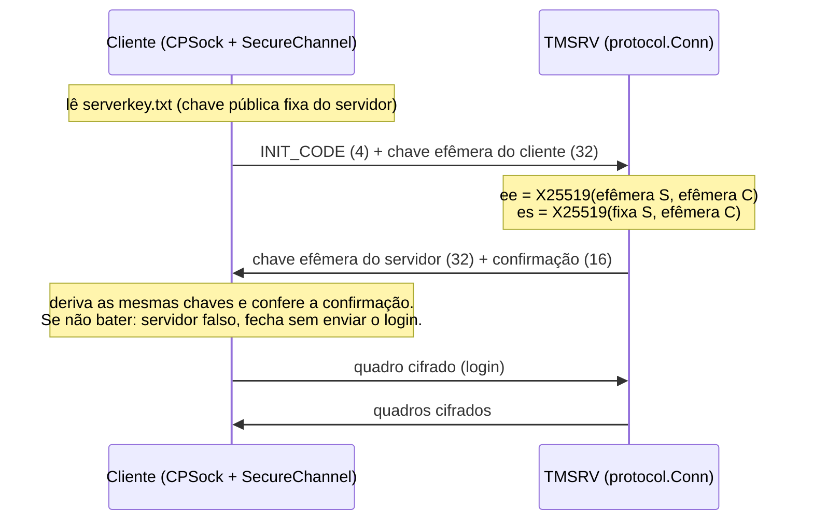

# Transporte seguro entre cliente e TMSRV

Desde 12/11/2026 a conexão do jogo é cifrada e autenticada por conexão. A
cifra de tabela fixa do WYD original (`KeyTable` / `pKeyWord`) continua só no
link TMSRV ↔ DBSRV, que não sai da rede privada do servidor.

É uma **quebra de protocolo**: cliente antigo não entra em servidor novo, nem
o inverso. Distribua os dois juntos, e o `serverkey.txt` junto com o cliente.

## O que resolve

| Antes | Agora |
|---|---|
| Qualquer pessoa no caminho da rede lia usuário e senha: a tabela é a mesma em todo cliente. | Cada conexão tem chaves próprias, que só o cliente e o servidor conseguem derivar. |
| Um servidor falso recebia o login normalmente. | O cliente só aceita quem tem a chave privada correspondente ao `serverkey.txt`. |
| Um pacote alterado no caminho era aceito (o checksum dependia só da chave e do tamanho). | Quadro alterado, repetido, fora de ordem ou descartado derruba a conexão. |
| Gravar uma sessão hoje e descobrir a chave do servidor depois revelava a sessão. | As chaves efêmeras somem ao fim da conexão: sessões gravadas continuam fechadas. |

Não resolve: cheat no próprio computador do jogador (ele tem as chaves da
conexão dele) e o HTTP do launcher e do cadastro (V2 do relatório).

## Como funciona



- Troca de chaves: X25519. As duas chaves da conexão (uma por sentido) são
  `BLAKE2b-512(chave = ee ‖ es, msg = "WYD-transport-v1" ‖ efêmera C ‖ efêmera S ‖ fixa S)`.
- Confirmação: tag ChaCha20-Poly1305 de uma mensagem vazia, nonce 0, na chave
  servidor → cliente.
- Quadro: `uint16 W` (tamanho do quadro) ‖ pacote cifrado a partir do byte 2 ‖
  tag de 16 bytes. ChaCha20-Poly1305 (RFC 8439), `W` como dado adicional,
  nonce = contador por sentido começando em 1.
- O pacote por dentro é o mesmo de antes (cabeçalho de 12 bytes + corpo). Os
  campos `KeyWord` e `CheckSum` viajam zerados. Cada pacote cresce 16 bytes.
- O cliente tem 10 segundos para concluir a troca; depois disso a conexão
  é fechada.

Implementação:

| Lado | Arquivos | Biblioteca |
|---|---|---|
| Servidor | `internal/protocol/secure.go`, `conn.go` | `crypto/ecdh` e `golang.org/x/crypto` |
| Cliente | `Projects/TMProject/SecureChannel.{h,cpp}`, `CPSock.cpp` | Monocypher 4.0.2 (`Dependencies/monocypher`) |

`TestVectorsMatchTheClient` guarda as chaves, a confirmação e um quadro
produzidos pelo código C++ com entradas fixas: se um lado mudar o esquema, o
teste falha.

## Chaves

```sh
go run ./cmd/admin transport-key -env .env -pub "../wyd-others/Release Cliente/serverkey.txt"
```

- A chave **privada** vai para o `.env` como `TMSRV_TRANSPORT_KEY` (base64) e
  nunca é mostrada. Todos os canais usam a mesma. Sem ela a TMSRV não sobe.
- A chave **pública** vai para `serverkey.txt` (64 dígitos hexadecimais), na
  pasta do jogo. Ela não é segredo, mas tem de chegar ao jogador junto com o
  cliente, e não baixada por HTTP: quem troca esse arquivo escolhe em que
  servidor o cliente confia.
- Rodar o comando de novo reaproveita a chave do `.env` e só reescreve o
  arquivo público.
- No servidor de produção, use o mesmo `.env` (ou copie a linha
  `TMSRV_TRANSPORT_KEY`). Uma chave diferente da que foi distribuída faz todo
  cliente recusar o servidor.

### Trocar a chave

Se a chave privada vazar: apague a linha do `.env`, rode o comando, reinicie os
canais e distribua o `serverkey.txt` novo. Clientes com o arquivo antigo param
de conectar até recebê-lo.

## Implantação

1. `go run ./cmd/admin transport-key -env .env -pub <pasta do jogo>/serverkey.txt`
2. `docker compose up -d --build` (ou `servidor restart` no Windows)
3. Cliente: `./wyd-linux.sh build` ou `build.ps1 -Deploy`, e distribua a pasta
   com o `WYD.exe` novo e o `serverkey.txt`.

Mensagens em `clientlogs.log` quando a conexão é recusada:

| Mensagem | Causa |
|---|---|
| `serverkey.txt ausente ou invalido` | O arquivo não está na pasta do jogo ou não tem 64 dígitos hexadecimais. |
| `O servidor nao respondeu a troca de chaves` | Servidor antigo, ou fora do ar. |
| `O servidor nao tem a chave de serverkey.txt` | `serverkey.txt` de outro servidor, ou alguém no meio do caminho. |

## TCP_NODELAY

O cliente agora liga `TCP_NODELAY` ao conectar. Sem isso o sistema segura
pacotes pequenos esperando juntar mais dados (algoritmo de Nagle), o que
atrasa ações rápidas. No servidor nada mudou: o Go já liga `TCP_NODELAY` em
toda conexão TCP por padrão.
